# TPS

TPS is your all-in-one dashboard for having Claude Code or pi (experimental) work on many tasks across many
projects at once. For each task you get an agent chat and a VS Code instance
side-by-side, backed by its own lightweight sandbox container and repository.

<p>
<a href="doc/tps1.png">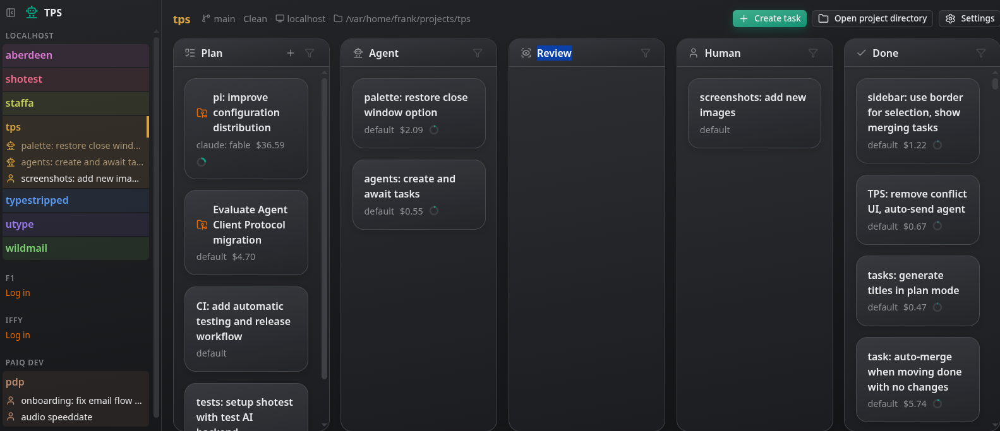</a>
<a href="doc/tps2.png">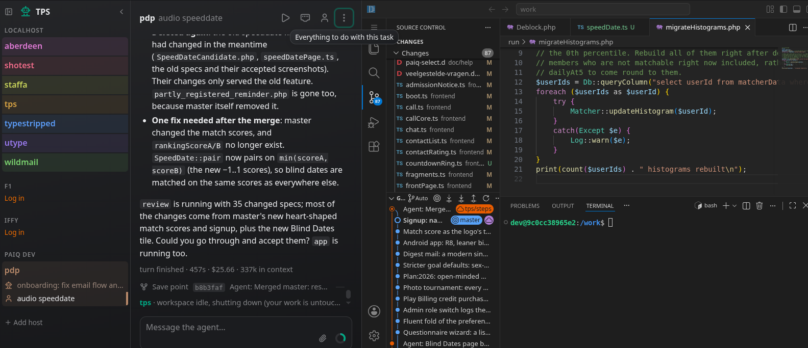</a>
</p>

## What makes it good

<table>
<tr><td width="320">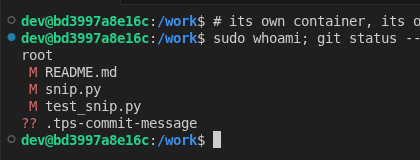</td><td>

**A sandbox per task.** Every task gets its own clone of your repository in
its own rootless container. Agents can't touch your checkout or each other, and
a task gone wrong is simply deleted.

</td></tr>
<tr><td width="320">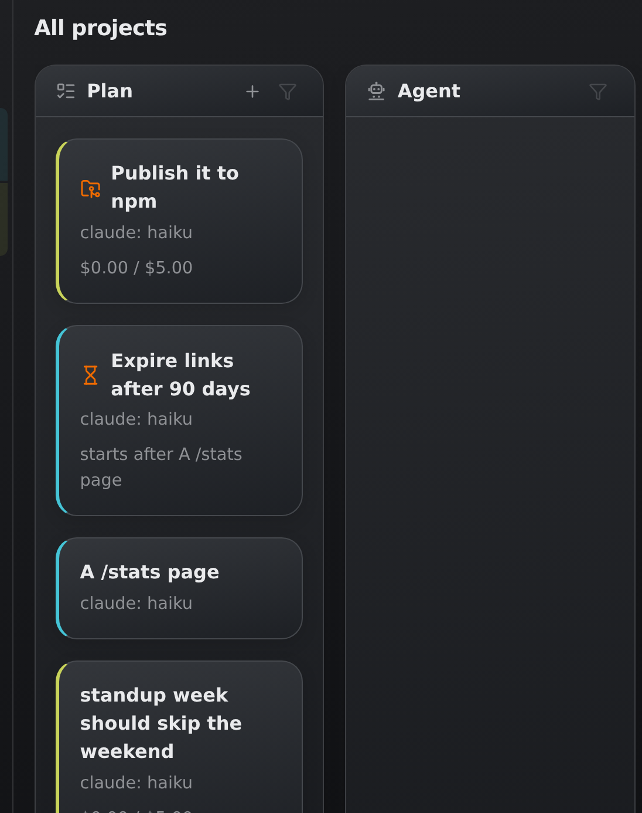</td><td>

**A Kanban board per project, and one for all of them.** What you're
planning, what agents are working on, what needs you and what's done, at a
glance.

</td></tr>
<tr><td width="320">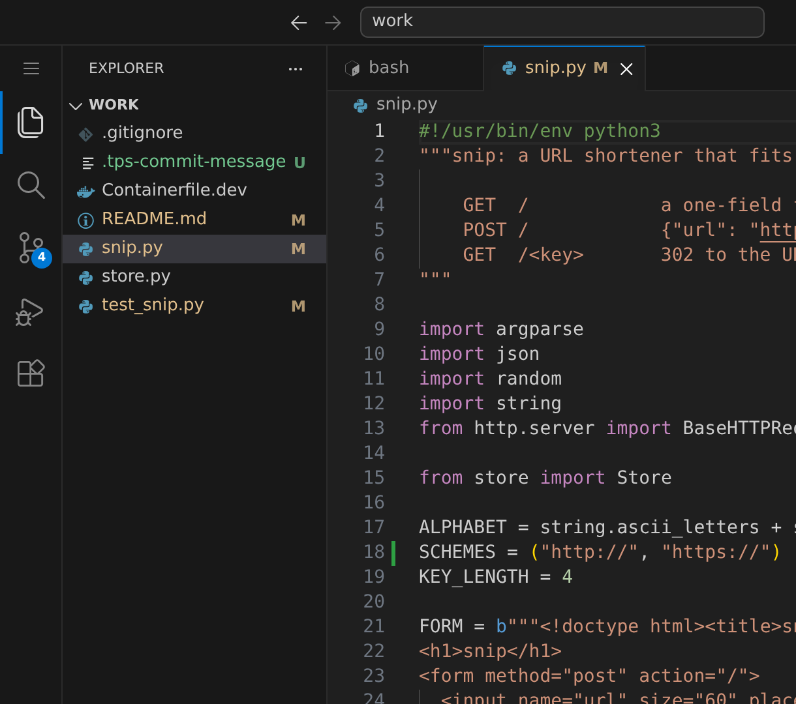</td><td>

**VS Code on every task.** In the browser, on the task's own files and
container. Read what the agent did, fix something yourself, run the tests.

</td></tr>
<tr><td width="320">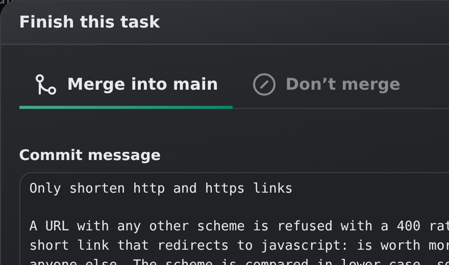</td><td>

**Merges that land themselves.** A finished task becomes one clean commit on
your branch, with a message the agent wrote. Conflicts go back to the agent,
and your test suite can gate what lands.

</td></tr>
<tr><td width="320">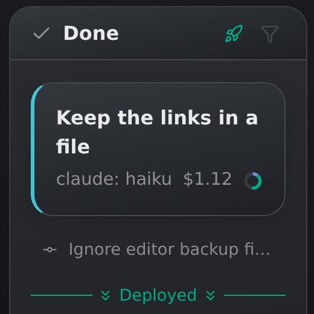</td><td>

**Deploys.** Point TPS at your deploy script and the Done column shows what is
live and what isn't. Deploy, or roll back, with a click. Releasing some other
way? Run `git update-ref refs/tps/deployed <commit>` in the project's checkout
on each release, and the column (and the agents, minding version numbers) know
what went out.

</td></tr>
<tr><td width="320">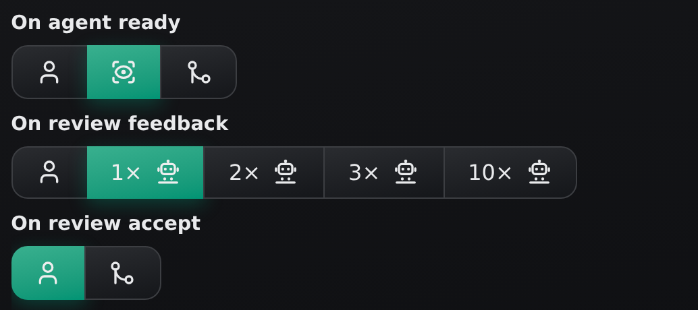</td><td>

**A second pair of eyes.** A reviewing agent can read the work over before you
do, checking it against what you asked for and trimming what isn't needed.

</td></tr>
<tr><td width="320">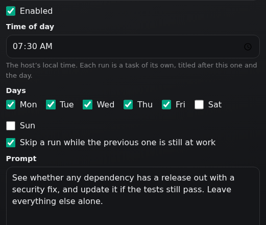</td><td>

**Scheduled tasks.** Have an agent do a chore every morning, or on the days you
pick: each run works on its own and lands its work, and only bothers you when
it really needs to.

</td></tr>
<tr><td width="320">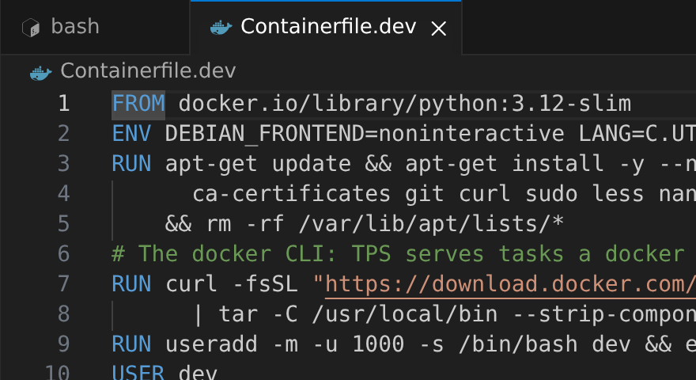</td><td>

**A project-specific environment.** A `Containerfile.dev` in your repository is
the image tasks run in. When the agent needs a tool, it adds it there itself.

</td></tr>
<tr><td width="320">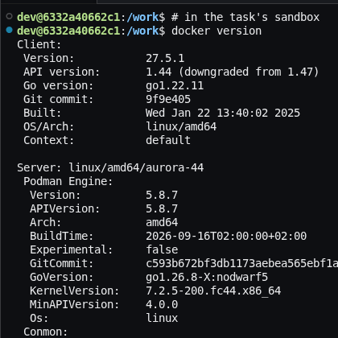</td><td>

**Containers within.** A Docker-compatible socket inside the sandbox, so tests
that need `docker` or `docker compose` (mostly) just work.

</td></tr>
<tr><td width="320">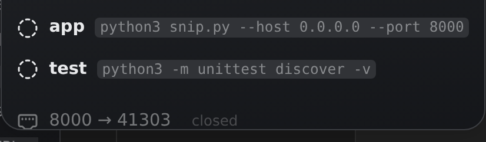</td><td>

**Services and ports.** Dev servers and test runs are named services you can
start, stop and read the output of. One click opens the app the agent is
working on.

</td></tr>
<tr><td width="320">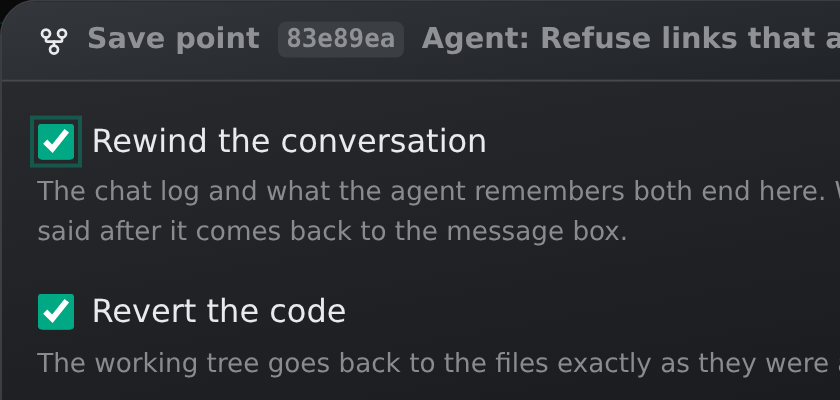</td><td>

**Revert and fork.** Every step is a save point. Take a task back to one, or
fork a new task from it — or just edit a message you sent.

</td></tr>
<tr><td width="320">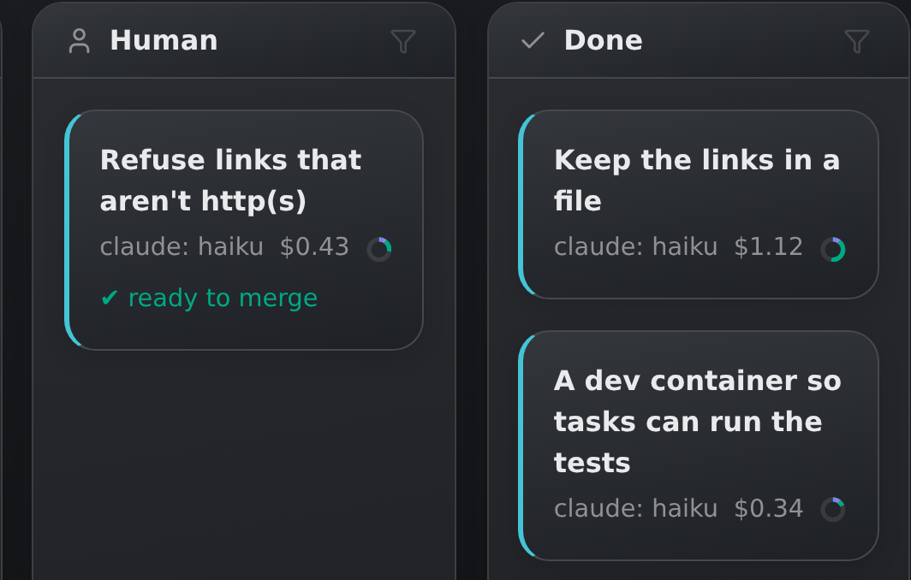</td><td>

**Follow-ups.** Message a finished task later, and its agent picks up on top of
the current code, remembering what it did the first time.

</td></tr>
<tr><td width="320">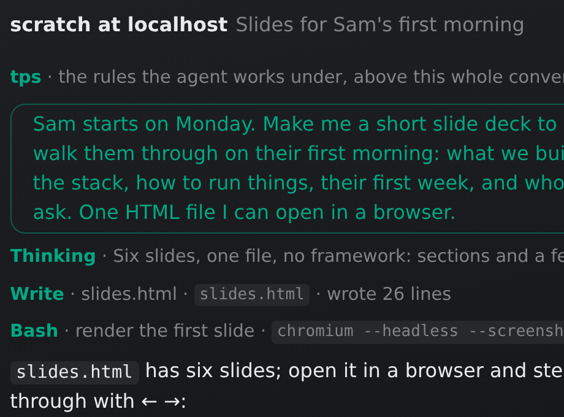</td><td>

**Scratch tasks.** For a question, some research or an experiment that belongs
to no project. One that grows into something can become a project of its own.

</td></tr>
<tr><td width="320">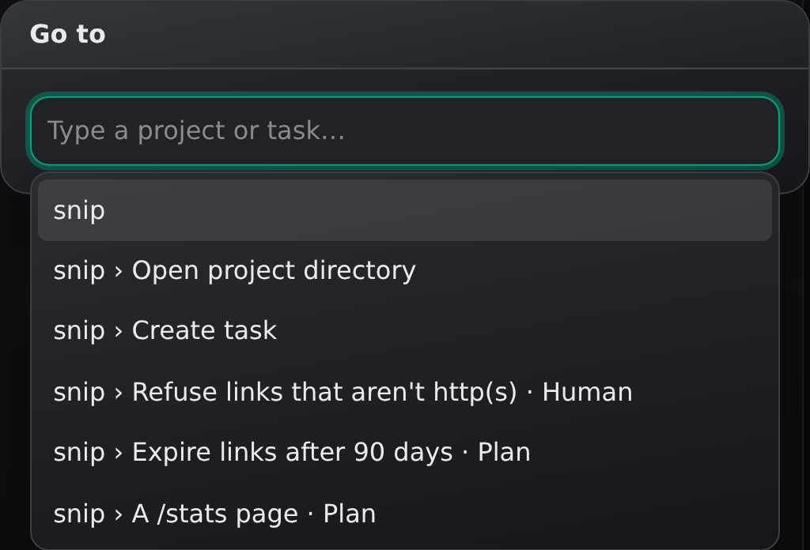</td><td>

**Many projects, one place.** The sidebar lists your projects and their active
tasks; ctrl-L gets you anywhere in a few keystrokes.

</td></tr>
<tr><td width="320">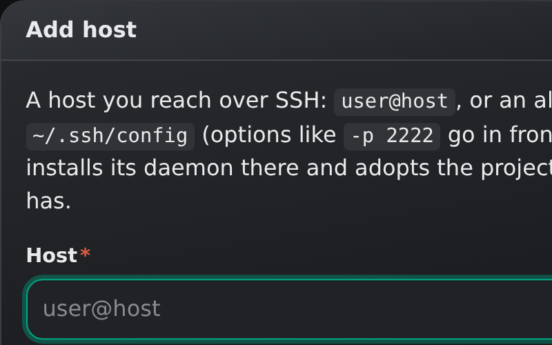</td><td>

**Any number of machines.** Add a host by whatever you'd type after `ssh`, and
its projects join the rest. Agents there keep working while your laptop sleeps.

</td></tr>
<tr><td width="320">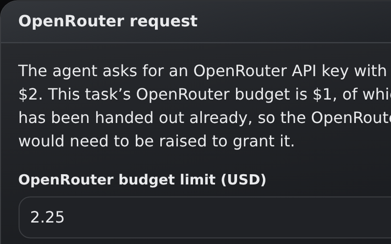</td><td>

**Image, audio and video models.** Agents can get an OpenRouter key, within a
budget you set, for media work or to test apps that call a model API.

</td></tr>
</table>

And of course: steering an agent mid-run, pasting screenshots and files, a model
per task, budgets, context-window insight, desktop notifications, and keyboard
shortcuts for what you do all day.

## Installing

TPS runs on Linux, any distribution. Every machine that runs projects needs:

- **podman**, 4 or later, set up rootless (the distro package normally does
  that), and **git**;
- a **login for the agent you run**: for Claude Code, a host without one says
  so in the sidebar, and its page signs you in through your browser (or set
  `ANTHROPIC_API_KEY`). For pi, it is the `~/.pi/agent` you log in with on that
  host. TPS brings both CLIs itself.

A host over SSH works best with lingering on (`loginctl enable-linger`), so its
agents keep working while you are disconnected; TPS tells you when it is off.

To let a machine wake from suspend for scheduled tasks, allow your user
`rtcwake` without a password, once:

```sh
echo "$USER ALL=(root) NOPASSWD: $(command -v rtcwake)" | sudo tee /etc/sudoers.d/tps-rtcwake
```

Every task's container counts toward one inotify limit: your user's on the
host, 128 instances on many distributions, which file watchers in a few tasks
use up. Raise it once:

```sh
echo fs.inotify.max_user_instances=4096 | sudo tee /etc/sysctl.d/90-tps-inotify.conf && sudo sysctl --system
```

Download a release into a bin directory of your own and start it:

```sh
mkdir -p ~/.local/bin
curl -fsSL -o ~/.local/bin/tps https://github.com/vanviegen/tps/releases/latest/download/tps-linux-$(uname -m)
chmod +x ~/.local/bin/tps
~/.local/bin/tps --auto-start
```

`--auto-start` makes TPS start at every login; the dashboard is at
<http://localhost:4820/>. To update, run the same `curl`, or add
`--auto-update` and TPS installs new releases itself.

### Use it as an app

Install the dashboard as an app: in a Chromium browser, click *Install* in the
address bar. TPS gets a window of its own, and in fullscreen (F11) VS Code gets
all its keys, ctrl-w included.

## Building from source

With Go 1.27 and Node:

```sh
npm install && npm run build       # bundles the web UI into web/dist
CGO_ENABLED=0 go build -o tps .    # embeds it into one static binary
```

Or, without installing either, in the project's own dev image:

```sh
podman build -t tps-dev -f Containerfile.dev . && podman run --rm --userns=keep-id:uid=1000,gid=1000 -v "$PWD:/work:z" tps-dev sh -c 'npm install && npm run build && CGO_ENABLED=0 go build -o tps .'
```

`./dev.sh` rebuilds and restarts on every change, `go test ./...` runs the
tests, and `./deploy.sh` tags a release on GitHub, which builds the binaries.

`demo/seed.sh` fills a home directory with two small projects and a board's
worth of tasks to click through; the dev container's `app` service runs it
before starting TPS. On a freshly seeded demo, `node doc/screenshots.mjs`
retakes the screenshots above.

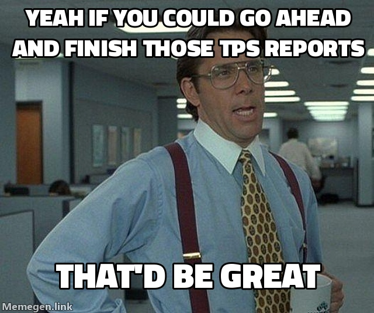
